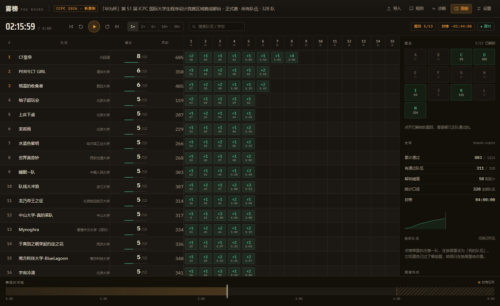

# 雾榜 FogBoard

**CCPC 2026 新赛制「赛时榜单」回放系统。**
导入 board.xcpio / xcpclink 导出的榜单 xlsx，按新赛制重建赛时榜单：主榜只有名次、通过数、罚时，以及「第 1 次、第 2 次…通过」的时刻 —— 你能看出谁在什么时候过题，但看不出那是哪一道题。题号只活在右栏：通过数达到阈值或封榜后，那张题卡才亮，点开才看得到通过名单。



## 快速开始

```bash
pnpm install
pnpm dev          # http://127.0.0.1:5173/
```

打开后点「成都站 / 秦皇岛站」的示例即可看到效果，也可以直接把 xlsx 拖进页面。

```bash
pnpm test         # 78 个单测：解析 / 罚时 / 排名 / 解锁 / 快照 / 格式化 / QOJ
pnpm build        # 产出 dist/，可直接静态托管
pnpm build:single # 产出 dist-single/FogBoard.html —— 单文件版，双击就能用
pnpm preview      # 预览构建结果
pnpm typecheck    # tsc --noEmit
node scripts/verify-ui.mjs      # 用本机 Chrome 跑一遍交互并截图
node scripts/verify-single.mjs  # 用 file:// 打开单文件版，确认内置榜单能加载
```

纯前端，文件只在浏览器里解析，不会上传。

### 单文件版（发给别人用）

`pnpm build:single` 会把 JS、CSS、字体和两份内置榜单全部内联进一个 `dist-single/FogBoard.html`（约 1.9 MB）。它不需要服务器、不需要联网，双击用浏览器打开就能用，也可以直接丢到群里：

- 打开后点内置示例，或者把 xlsx 拖进去；
- 设置、播放、封榜、QOJ 粘贴导入全都正常；
- 浏览器回收站式的老版本 IE 肯定不行，Chrome / Edge / Firefox 近几年的版本都没问题。

数据只在你自己的浏览器里解析，单文件版同样不联网。

## 它模拟的规则

设 N = 榜单队伍数，k = 生效阈值。默认 `k = min(50, ⌈20% × N⌉)`（两条规则任一满足即可；也可以改成「同时满足」、单独关掉某条、或直接改数字）。

| | |
|---|---|
| **R1** | 主榜 = 名次 / 队伍 / 通过数 / 罚时 / 第 1…15 次通过。每次通过只给「第几次、几次提交、什么时刻」，不给题号。 |
| **R2** | 锁定题目被通过照样计入：通过数 +1、罚时增加、多一格"第 k 次通过"。 |
| **R3** | 一道题被 k 支队伍通过后，右栏这张题卡亮起（解锁时刻 = 该题第 k 个 AC 的时刻），点开能看到通过名单。 |
| **R4** | 封榜（默认 4:00）时剩余题卡一并亮起；但榜单数据冻结在封榜时刻，封榜后的新通过不可见。 |
| **R5** | 终榜（5:00 或手动「解封」）显示完整数据；队伍抽屉里才会出现未通过题目的错误提交次数。 |

设置面板里可以改：固定阈值、百分比、两条规则的关系、封榜时刻、比赛时长、每次罚时、统计口径（全部 / 仅正式队）、「我的队伍」、以及两个调试开关（显示未解锁题的进度、显示完整信息）。

### 回放时钟

播放时刻 = 锚点时刻 + (现在 − 锚点墙钟) × 倍速，**按墙钟推算而不是按帧累加**。所以把标签页切到后台（浏览器会冻结 `requestAnimationFrame`）时，时钟照样在走；切回来的一瞬间会直接追平到你本该看到的位置 —— 挂着 VP 去写题，回来不会发现榜单还停在 0:30。系统时钟被往回拨时不会倒退。

「我的队伍」是唯一的信息豁免：选手本来就知道自己过了哪些题，所以队伍抽屉里它的逐题明细永远可见，封榜期间也照常更新。

### 快捷键

`空格` 播放/暂停 · `←/→` ±10 秒（`Shift` ±1 分钟）· `Home/End` 开头与终榜 · `U` 解封/复原 · `Esc` 关闭弹层

## 支持的数据格式

两种导出都自动识别，包括表头不在第一行、一个文件里有多张工作表的情况（正式 / 打星 / 省赛 / 女队等）。

### board.xcpio 导出

- 表头示例：`Rank, Organization Rank, Organization, Team, Solved, Penalty, A…M, Dirt, [Medal,] Member1…3, [Coaches,] Unofficial, Girl, ICPC ID`
- 单元格：`+k(mm)` 通过（k = 该题提交总次数含通过的一次，mm = 通过时刻，单位分钟）、`-n` 未通过（n = 错误提交次数）、`-` 无提交。
- 罚时按 `Σ(通过时刻 + 20 × (k−1))` 重算，已用成都站 328 支队逐队验证与文件中的 `Penalty` 完全一致。

### xcpclink 导出

- 表头示例：`邀请赛#, 省赛#, R#, S#, Markers, Official, Organization, Name, Team Members, Score, Time, A (72/340), …`
- 单元格：`AC/k/H:MM:SS`、`FB/k/H:MM:SS`（首杀）、`RJ/n`、空。
- `Time` 列是 `h:mm:ss` 的累计罚时；重算后与文件 375/375 队秒级一致。
- 表头 `(72/340)` 的第一个数与实算 AC 数完全吻合，第二个数口径不明（例如 J 题 669 与实算提交数 607 不符），因此只作为展示信息，所有统计一律以实算为准——诊断面板会列出这类差异。

### QOJ 榜单（粘贴导入）

qoj.ac 全站挂在 Cloudflare 的 JS 挑战后面：`curl` / Node 直接请求返回 403 `Just a moment...`，`/contest/{id}` 还会 302 到登录页。**任何脚本都抓不到**，而且榜单本身不提供下载 —— 数据只能从你自己的浏览器里出来。

三条输入路径，同一个粘贴框，自动识别：

| 你怎么做 | 粘进去的东西 |
|---|---|
| **在榜单页 `Ctrl+A` → `Ctrl+C`**（最省事） | 整页纯文本 |
| 榜单页 `F12` → Console → 跑「复制抓取脚本」 | JSON（单元格文本 + `title` + `data-*`） |
| `Ctrl+S` 另存网页 | HTML |

纯文本那种就是 `Rank. / Username / A / 32/41 / B / …` 这种"单元格内换行、列之间制表符"的混合，解析器把它摊平成 token 流：名次、队名、然后每格是「状态 + 可选时刻」，最后是 Solved / Penalty / Dirt，`Submissions:` 这段页脚直接截断。

QOJ 的格子写法是 `+k 1:06`：**`k` 是错误次数**（和 board.xcpio 的 `k−1` 相反），所以 `attempts = k+1`、`罚时 = 时刻 + 20×k`。`*+` 表示首杀，`-11` 是 11 次错误提交，单独的 `-` 是没提交。`队名 (队员, 队员)` 会拆成队名 + 队员。

时刻默认按 `h:mm` 解读；如果榜单其实是 `m:ss`，解析器会用榜面的 Penalty 列反推校验并自动切换。

已用两组真实数据校验：`qoj.ac/results/ICPCCamp2026Day1` 的 4 支队（`fixtures/qoj-demo.json`），以及整页复制出来的文本里的 5 支队（`fixtures/qoj-paste.txt`：USA1 11/835、THU1 11/1042、Nameless Dreamer 10/942、Almost Retired Dandelion 10/984、Jury 0/0），逐项与榜面一致。

唯一的硬限制：榜单里必须带通过时刻。只有 `+`/`−` 没有时间的页面会直接报错，而不是给你一个假的回放。

## 数据边界（重要）

导出文件里每题只有一条**聚合结果**（第几次提交通过、通过了多少个错误），没有逐条提交记录。因此：

- ✅ 通过时刻、任意时刻的通过数 / 罚时 / 名次 —— 精确。
- ❌ 错误提交发生的时刻 —— 未知。所以赛时回放里未通过的格子不显示 `−n`，只在终榜/解封后显示；通过的那一刻会一次性显示 `+k`。
- ❌ 封榜期间「看得到提交、看不到结果」的中间态 —— 无法重建，这里实现的是整榜冻结。

页面里的「规则」弹窗与「诊断」面板都写明了这一点。

## 结构

```
src/
├─ App.tsx                     # 状态编排、导入、快捷键、空状态
├─ components/
│  ├─ Board.tsx                # 主榜：名次 / 队伍 / 通过 / 罚时 / 第 k 次通过
│  ├─ Playback.tsx             # 播放条与时间轴
│  ├─ Rail.tsx                 # 右栏：题目卡与题目详情、全场统计、我的队伍
│  ├─ Dialogs.tsx              # 设置 / 导入 / 规则 / 诊断 / 队伍抽屉
│  └─ ui.tsx                   # 图标、Modal、Toast 等
├─ lib/
│  ├─ parse/                   # xlsx 读取、格式识别、xcpcio / xcpclink / QOJ 归一化
│  ├─ model/                   # 聚合、排名、快照（时间切片）
│  ├─ rules/                   # 阈值与解锁、设置持久化
│  └─ types.ts / format.ts
├─ state/usePlayback.ts        # rAF 播放时钟（节流推送 UI）
└─ styles/app.css              # 全部视觉样式
```

核心链路：`parseWorkbook → analyzeSheet → parseXcpcio/parseXcpclink → createContest → buildIndex → computeUnlocks → buildSnapshot(t)`。快照是纯函数，播放时按时间切片重算，因此任意时刻拖拽都是精确的。

## 测试

```
pnpm test
```

- 解析：成都站 328 队 / 1214 次通过 / 罚时 328 队全对；秦皇岛站 375 队 / 1943 次通过 / 罚时 375 队秒级全对；首杀标记。
- 排名：终榜名次与导出文件的 `Rank` 逐队一致（含并列名次）。
- 解锁：成都 M 20:00、D 29:00、K 1:20、C 2:01、I 2:11，其余 4:00；秦皇岛 B 1:42、I 9:46、J 15:04、H 16:01、E 1:12:07、K 3:06:27、A 3:18:32，其余 4:00。
- 快照：0:00 全锁、4:00 题卡全亮并冻结、5:00 终榜与文件一致、手动解封、通过顺序按时间排列且含锁定题、我的队伍豁免、口径切换。
- 格式化：分钟精度 / 秒级精度的通过时刻、罚时取整、时钟与时间轴刻度、`h:mm:ss` 解析。
- QOJ：表头/列定位、`+k` 当错误次数、`h:mm` 与 `m:ss` 自动判别、`-` 与 `-15` 的区分、内置示例 4 队的通过数/罚时与榜面一致。

`node scripts/verify-ui.mjs` 会真实加载三份榜单（成都、秦皇岛、QOJ 示例），断言行数 / 列数（4 + 15 个通过位）/ 题卡点亮数 / 题目详情的通过名单 / 封榜状态 / 抽屉里的雾格数，并截图到 `docs/screenshots/`。

## 已知限制

- 只支持这两种导出；其它格式需要在 `src/lib/parse/` 里加一个解析器。
- 1000+ 队的榜单没有做虚拟滚动（当前用 `content-visibility` 兜底），600 队量级流畅。
- 规则口径以本项目实现为准：官方原文未公开抓取到（知乎正文 403、官网为 SPA），因此所有参数都做成了可配置项，页面上也写了实现口径。
